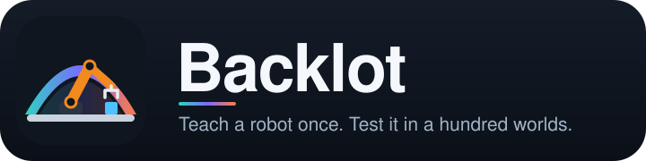

<p align="center"></p>

# Backlot

Teach a robot a task once in VR, let a live world model show it that task in a hundred different
worlds, then watch it do the task alone in a world it has never seen.

Built for Immerse the Bay 2026 (Stanford XR hackathon). Runs in the Quest Browser on a Meta Quest 3
via WebXR, and on a laptop browser with a mouse.

- You control a simulated robot arm with your hand (or the mouse) and complete three challenges:
  **Reach**, **Place**, **Sort**. Every attempt is recorded (time, success, arm motion).
- Behind the arm is a large curved wall showing a live AI-generated world from
  **Visko Orbis** (a real-time video model). You switch worlds with buttons.
- Your demos are replayed in front of many generated worlds to build an image dataset; a small
  camera-based policy trained on it then does the task alone (measured result below).
- **Robot Workshop**: pick the right robot for the job. Build a robot from 5 arms and 8 tools and solve
  16 challenges; a wrong part fails and says why. Each attempt puts a new generated world on the wall.

## What is real and what is simulated

- The arm is simulated and kinematic (closed-form IK, snap-to-grab, no physics engine).
- Orbis generates only the video on the wall behind the arm. It does not simulate the robot.
- Nothing here claims to improve a real robot. Results are reported only as measured.

## Result

Two policies with the same code and training budget, evaluated on live Orbis walls on the Place task
(20 seeds per world, run once, nothing tuned on it):

| Policy | Lab | 3 unseen generated worlds |
| --- | --- | --- |
| Trained on the lab only | 8/20 (40%) | 15/60 (25%) |
| Trained on 8 generated worlds | 10/20 (50%) | **27/60 (45%)** |

Same seed and world compared, the many-world policy alone succeeded 20 times and the one-world policy alone 8
(exact McNemar p = 0.036). Neither policy is reliable even in the lab; the arm is simulated. Details and limits:
[docs/STATUS.md](docs/STATUS.md#real-result-m4-live-orbis-walls-run-2026-11-15t00-39-44-104z-datasummaryjson).

## Run it

Requirements: Node 18+. Python 3.10+ with PyTorch for the data and training milestones.

```bash
npm install
npm run dev          # http://localhost:5173
```

**Without a key** the wall runs on a built-in stub world (an animated canvas, no network).
Everything works except the live Orbis stream.

**With a key**, copy `.env.example` to `.env` and set `REACTOR_API_KEY=rk_...`. The key is read
only by the dev server, which mints short-lived session tokens; it is never sent to the browser.

### Desktop controls

| Input | Action |
| --- | --- |
| Mouse move | arm target follows the cursor (horizontal plane) |
| Wheel or W / S | raise / lower the target |
| Click or Space | toggle the gripper |
| 1 to 6 | switch world |
| Say a world (Worlds panel) | speak a place to make a custom world (where the browser supports speech) |

URL options: `?orbis=0` keeps the stub wall (no Orbis session, no cost); `?challenges=egg,bucket` limits the
Workshop to those challenges.

### Quest 3

```bash
adb reverse tcp:5173 tcp:5173
```

Open `http://localhost:5173` in Quest Browser and press Enter VR. The right hand drives the arm
(pinch to grip); poke the panels with a fingertip. Controllers work as a fallback (grip pose +
trigger). The headset still needs internet for the Orbis stream.

"Say a world" listens for 8 s at most and shows why when it hears nothing. In the Quest Browser it currently
never returns a phrase; use the world buttons there.

### Robot Workshop

Press **Robot Workshop** on the side panel, then **Start**. The parts panel sits on the left (beside Worlds in
the headset). Pick an arm and a tool; changing a part rebuilds the arm and restarts the challenge, except in swap
challenges (Dinner, Restock, Cleanup), where you change parts mid-run. A failed grab wobbles, buzzes and shows
the reason ("Too heavy for this arm", "Air leaks through the slats", "Too hard a grip: it would crack the egg").
Every attempt is recorded with its arm, tool, failed grabs, world and swaps, and replays rebuild that robot.
**Back to the standard robot** leaves it; Reach / Place / Sort, the data factory, training and Robot's turn
always use the standard robot (Compact arm + Gripper).

- Arms: Compact (standard), Long, Heavy-duty, Tall base, Extra-long.
- Tools: Gripper (standard), Suction, Magnet, Wide gripper, Scoop, Soft gripper, Hook, Big suction.
- Challenges: Plate, Far, Heavy, Washer, Crate, Anvil, Marbles, Shelf, Cart, Egg, Scrap, Restock, Dinner,
  Bucket, Pane, Cleanup.

Each part and challenge is one file in `src/workshop/parts/` and `src/workshop/challenges/`; delete a name from
`ENABLED_PARTS` / `ENABLED_CHALLENGES` in `src/config.ts` to switch it off. Full table of what solves what:
[docs/WORKSHOP.md](docs/WORKSHOP.md).

### Multiply, data factory, training, evaluation

Python setup (one time). PyTorch must support your GPU; RTX 50-series needs a CUDA 12.8+ build:

```bash
python -m venv --system-site-packages .venv
.venv/Scripts/python -m pip install websockets pytest
```

1. **Multiply** (in the app): finish the challenges, then press *Multiply my Place demo*. Your Place
   demo replays in all eight training worlds while a counter and a thumbnail wall fill.
2. **Build datasets** (laptop browser, needs the live wall for `single` and `multi`):

   ```bash
   .venv/Scripts/python py/data_server.py
   node scripts/run-factory.mjs "dataset=multi&episodes=2000"
   node scripts/run-factory.mjs "dataset=single&episodes=2000"
   .venv/Scripts/python py/view_dataset.py data/datasets/multi     # contact sheet
   ```

   Without a key, use `dataset=smoke-multi&schedule=multi` (stub walls, pipeline testing only).
   On the smoke data, 300 episodes per dataset was too few for the policies to learn the task; 2,000 worked.
3. **Train** (same code and settings for both, 15 minutes each; run the overfit check first). The image head
   is a spatial-softmax keypoint layer by default; `--pool avg` gives the spec's global-average-pooling model:

   ```bash
   .venv/Scripts/python py/train.py --data data/datasets/multi --overfit 5
   .venv/Scripts/python py/train.py --data data/datasets/multi  --out data/ckpt/multi.pt
   .venv/Scripts/python py/train.py --data data/datasets/single --out data/ckpt/single.pt
   ```
4. **Evaluate** (stop the data server first; both use port 8765):

   ```bash
   .venv/Scripts/python py/serve.py --ckpt multi=data/ckpt/multi.pt --ckpt single=data/ckpt/single.pt
   node scripts/run-eval.mjs            # or open /?mode=eval and press Run
   .venv/Scripts/python py/report.py
   ```
5. **Robot's turn** (M5): with `serve.py` running and a summary present, the results card shows
   *Robot's turn*. In the headset also run `adb reverse tcp:8765 tcp:8765`.

### Tests

```bash
npm test                                   # unit tests
npm run e2e                                # Playwright end-to-end in headed Chromium
.venv/Scripts/python -m pytest py/tests    # data server, training, serving, report
npm run test:modular                       # Workshop only: every robot against every challenge, rules, swaps
npm run e2e:modular                        # Workshop only, desktop: wrong parts then right parts, every button
```

Last full run (Sun Nov 15): typecheck clean, Vitest 1115/1115, pytest 19/19, Playwright 20 passed and 1 skipped
(the no-key test skips when a key exists). Two failed: Scrap, the known intermittent mouse-helper flake, passed on
rerun; Shelf's test carried the jar under the desktop side panel and was fixed afterwards.

## Docs

- [docs/PLAN.md](docs/PLAN.md) — milestones, demo script, what we may and may not claim
- [docs/SPEC-M1-app.md](docs/SPEC-M1-app.md) — arm, challenges, recording
- [docs/SPEC-M2-orbis.md](docs/SPEC-M2-orbis.md) — live Orbis wall
- [docs/SPEC-M3-factory.md](docs/SPEC-M3-factory.md) — data factory
- [docs/SPEC-M4-policy.md](docs/SPEC-M4-policy.md) — policy training, evaluation, live mode
- [docs/WORKSHOP.md](docs/WORKSHOP.md) — Robot Workshop: parts, challenges, switches, headset checks
- [docs/AUTONOMOUS.md](docs/AUTONOMOUS.md) — rules for the autonomous Workshop run
- [docs/STATUS.md](docs/STATUS.md) — current build status, measured results, Orbis minutes

## License

MIT. See [LICENSE](LICENSE).
