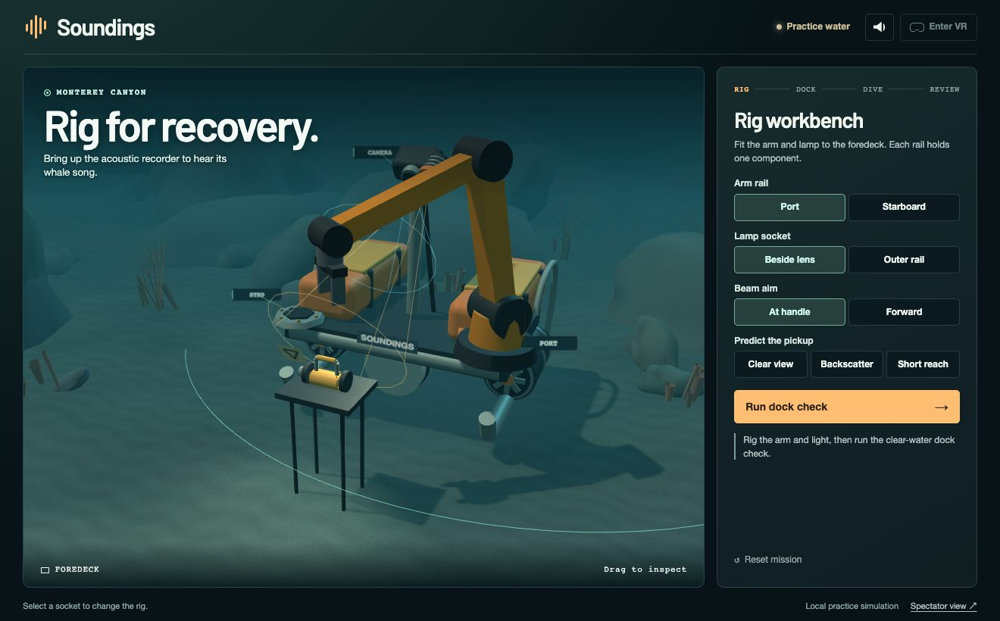

# Soundings

Rig an underwater robot on a Meta Quest 3, pilot its arm through a fixed mast camera, and recover an acoustic recorder in Monterey Canyon. Moving the floodlight changes the water you can see through. Moving the arm changes which pickups you can reach. A successful recovery unlocks a whale recording. Built for Stanford Gaming and the Visko Living Worlds interactivity prize.



## Run the game

Use Node 22.12+ or 24, npm, and a WebGL 2 browser. The Soundings game needs no Python service.

```sh
npm ci
npm run dev
```

Open [Soundings](http://localhost:5173). For a built demo, run `npm run build` and `npm run preview` with the development server closed. Both servers provide the local API. Practice works without credentials. The explicit [practice launch](http://localhost:5173/?orbis=0) prevents a paid Orbis connection.

For **live Orbis**, register for the Visko team key. Copy `.env.example` to `.env`, set `REACTOR_API_KEY` there, then start or restart the server. The first pointer interaction or **Connect Orbis** prewarms a session. Wait for **Orbis live** and moving water. The server mints short-lived session tokens. Keep the key on the laptop.

For **Quest**, enable developer mode, connect USB, accept debugging inside the headset, and run:

```sh
adb devices -l
adb reverse tcp:5173 tcp:5173
```

Open `http://localhost:5173` in Quest Browser and select **Enter VR**. Open the [spectator view](http://localhost:5173/?mode=spectator) on the laptop to display the same mounted camera and dive status. Both browser sessions must use this server. The headset needs internet for live Orbis.

## Play and teach

- **Rig.** Inspect the fixed center camera and three accessory sockets. Mount the arm on either outer rail. Place the lamp beside the lens or on the free rail, then aim forward or inward. Use the controls or, in VR, point at a fitted part, hold pinch or trigger, then release over a free compatible socket. To exchange occupied rails, park the lamp at the inner socket first.
- **Pilot.** Run the dock check by touching the exposed handle. Predict a failure, launch the canyon dive, read the symbol, close on the top handle, lift above the cage lip, center over the marked cradle, and release. On Quest, begin with your right hand relaxed near the center of your body. Move it to steer; pinch to close and open to release. A controller's trigger operates the same jaws. On desktop, aim with the pointer, scroll or use W/S for height, and click the feed or press Space to toggle the jaws.
- **Observe.** **Steer water · hold pose** holds the tool still and changes the water condition in the current session. Wait for a visible change and select **Capture changed water**. Review an attempt or return to the workbench at any point. A working first build can recover the recorder immediately.
- **Review.** Compare the flown lamp and alternate socket against one frozen water image and tool pose. If you ran the water test, compare the two displayed water conditions at the same pose as well. Try the opposite-side pickup to test what you learned. **Reset mission** starts a fresh pilot log.
- **Records.** The server saves 30 Hz traces, predictions, symbol answers, steering requests, actual sensor captures and outcomes in `data/soundings/sessions/<session>/<attempt>.json`. Captures carry their practice/live source and media timestamp. In the demo client, failed uploads remain queued locally in IndexedDB for reconnection. Use the judge guide for the timed walkthrough and verification record.

[Judge script and validation](docs/SOUNDINGS-DEMO.md) · [Soundings design brief](docs/IDEAS.md) · [Recording credits](public/audio/CREDITS.txt)

## Backlot research modes

The original robot-learning workbench remains at [Backlot](http://localhost:5173/?mode=app). Its factory and evaluation modes share the existing arm and data pipeline.

Teach a robot a task once in VR, let a live world model show it that task in a hundred different
worlds, then watch it do the task alone in a world it has never seen.

Built for Immerse the Bay 2026 (Stanford XR hackathon). Runs in the Quest Browser on a Meta Quest 3
via WebXR, and on a laptop browser with a mouse.

- You control a simulated robot arm with your hand (or the mouse) and complete three challenges:
  **Reach**, **Place**, **Sort**. Every attempt is recorded (time, success, arm motion).
- Behind the arm is a large curved wall showing a live AI-generated world from
  **Visko Orbis** (a real-time video model). You switch worlds with buttons.
- Later milestones replay your demos in front of many generated worlds to build an image dataset,
  train a small camera-based policy on it, and let the trained robot do the task alone.

## What is real and what is simulated

- The arm is simulated and kinematic (closed-form IK, snap-to-grab, no physics engine).
- Orbis generates only the video on the wall behind the arm. It does not simulate the robot.
- Nothing here claims to improve a real robot. Results are reported only as measured.

## Run it

Requirements: Node 18+. Python 3.10+ with PyTorch for the data and training milestones.

```bash
npm install
npm run dev          # http://localhost:5173
```

**Without a key** the wall runs on a built-in stub world (an animated canvas, no network).
Everything works except the live Orbis stream.

**With a key**, copy `.env.example` to `.env` and set `REACTOR_API_KEY=rk_...`. The key is read
only by the dev server, which mints short-lived session tokens; it is never sent to the browser.

### Desktop controls

| Input | Action |
| --- | --- |
| Mouse move | arm target follows the cursor (horizontal plane) |
| Wheel or W / S | raise / lower the target |
| Click or Space | toggle the gripper |
| 1 to 6 | switch world |

### Quest 3

```bash
adb reverse tcp:5173 tcp:5173
```

Open `http://localhost:5173/?mode=app` in Quest Browser and press Enter VR. The right hand drives the arm
(pinch to grip); poke the panels with a fingertip. Controllers work as a fallback (grip pose +
trigger). The headset still needs internet for the Orbis stream.

### Multiply, data factory, training, evaluation

Python setup (one time). PyTorch must support your GPU; RTX 50-series needs a CUDA 12.8+ build:

```bash
python -m venv --system-site-packages .venv
.venv/Scripts/python -m pip install websockets pytest
```

1. **Multiply** (in the app): finish the challenges, then press *Multiply my Place demo*. Your Place
   demo replays in all eight training worlds while a counter and a thumbnail wall fill.
2. **Build datasets** (laptop browser, needs the live wall for `single` and `multi`):

   ```bash
   .venv/Scripts/python py/data_server.py
   node scripts/run-factory.mjs "dataset=multi&episodes=2000"
   node scripts/run-factory.mjs "dataset=single&episodes=2000"
   .venv/Scripts/python py/view_dataset.py data/datasets/multi     # contact sheet
   ```

   Without a key, use `dataset=smoke-multi&schedule=multi` (stub walls, pipeline testing only).
   On the smoke data, 300 episodes per dataset was too few for the policies to learn the task; 2,000 worked.
3. **Train** (same code and settings for both, 15 minutes each; run the overfit check first). The image head
   is a spatial-softmax keypoint layer by default; `--pool avg` gives the spec's global-average-pooling model:

   ```bash
   .venv/Scripts/python py/train.py --data data/datasets/multi --overfit 5
   .venv/Scripts/python py/train.py --data data/datasets/multi  --out data/ckpt/multi.pt
   .venv/Scripts/python py/train.py --data data/datasets/single --out data/ckpt/single.pt
   ```
4. **Evaluate** (stop the data server first; both use port 8765):

   ```bash
   .venv/Scripts/python py/serve.py --ckpt multi=data/ckpt/multi.pt --ckpt single=data/ckpt/single.pt
   node scripts/run-eval.mjs            # or open /?mode=eval and press Run
   .venv/Scripts/python py/report.py
   ```
5. **Robot's turn** (M5): with `serve.py` running and a summary present, the results card shows
   *Robot's turn*. In the headset also run `adb reverse tcp:8765 tcp:8765`.

### Tests

```bash
npm test                                   # unit tests
npm run e2e                                # Playwright in Chromium (HEADED=1 shows the browser)
.venv/Scripts/python -m pytest py/tests    # data server, training, serving, report
```

## Docs

- [docs/PLAN.md](docs/PLAN.md) — milestones, demo script, what we may and may not claim
- [docs/SPEC-M1-app.md](docs/SPEC-M1-app.md) — arm, challenges, recording
- [docs/SPEC-M2-orbis.md](docs/SPEC-M2-orbis.md) — live Orbis wall
- [docs/SPEC-M3-factory.md](docs/SPEC-M3-factory.md) — data factory
- [docs/SPEC-M4-policy.md](docs/SPEC-M4-policy.md) — policy training, evaluation, live mode
- [docs/STATUS.md](docs/STATUS.md) — current build status

## License

MIT. See [LICENSE](LICENSE).
