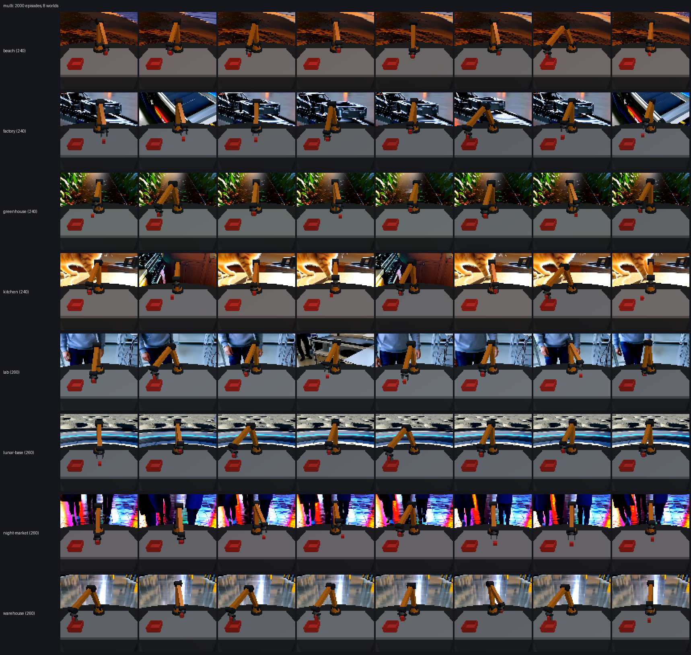
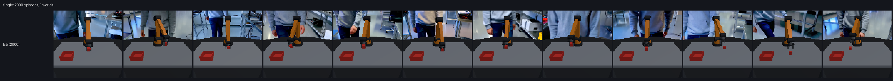

# Collected data

Everything Backlot records lives on the laptop in `data/`. That folder is not committed (about 250 MB of datasets
alone), so this page shows what is there, with a few real samples copied into
[`docs/evidence/`](evidence/). Counts are from Sun Nov 15, 07:58 PST.

## At a glance

| What | Where on the laptop | How much |
| --- | --- | --- |
| Attempt records: one file per challenge attempt | `data/sessions/<session>/<attempt>.json` | 404 attempts in 149 sessions, 41,609 motion samples |
| Training images: camera frames of the arm in front of the live wall | `data/datasets/multi/`, `data/datasets/single/` | 2,000 episodes each, about 46,000 frames each (96 x 96 px) |
| Trained policies | `data/ckpt/` | `multi.pt` and `single.pt` |
| Evaluation on unseen generated worlds | `data/results/summary.json`, `eval.json` | 160 episodes, all on a live Orbis wall |
| Orbis usage log | `data/orbis-usage.json` (`GET /api/usage`) | minutes per session |

## Training images

Both datasets were recorded by replaying a scripted expert on the Place task in front of a live Orbis wall
(no stub frames). **multi** cycles through 8 generated worlds, changing every 20 episodes (about 100
generations). **single** uses the lab world only. Contact sheets (random frames, one row per world):

Each episode is an `.npz` file with `images` (frames x 96 x 96 x 3), the actions, and `meta` (world, prompt,
seed, noise, success, steps). Regenerate a contact sheet with
`.venv/Scripts/python py/view_dataset.py data/datasets/multi`.

## Evaluation

[`evidence/eval-summary.json`](evidence/eval-summary.json) holds the totals and protocol;
[`evidence/eval-episodes.json`](evidence/eval-episodes.json) has one row per episode (policy, world, seed, success).
Result: the policy trained on 8 worlds placed the cube 27/60 times in 3 unseen generated worlds, the lab-only
policy 15/60 (exact McNemar p = 0.036 on matched seed and world). Limits are in the README "Result" section.

## Attempt records

Every challenge attempt, in the app or the headset, is saved by the dev server. Two real samples:

- [`attempt-headset-place.json`](evidence/attempt-headset-place.json): a Place attempt done by hand in the Quest 3.
- [`attempt-workshop-dinner-swap.json`](evidence/attempt-workshop-dinner-swap.json): a Robot Workshop Dinner run that
  swapped Gripper to Suction to Gripper mid-run, with one failed grab.

Fields: `challenge`, `seed`, `world` (id and the exact Orbis prompt), `input` (`hand`, `controller` or `mouse`),
`durationMs`, `success`, `drops`, `wrongBin`, `pathLengthM`, and in the Workshop `arm`, `tool`, `grabFails` and
`swaps` (`at` = sample index). `samples` is the motion at 30 Hz: hand target, grip, tip position, joint angles,
held object and object positions. The app replays any record exactly (`tests/` re-runs every saved attempt).

What the 404 attempts are, honestly:

| Input | Attempts | Solved | Notes |
| --- | ---: | ---: | --- |
| Hand, in the Quest 3 | 13 | 12 | Reach, Place, Sort and the first Workshop challenges |
| Mouse | 391 | 391 | mostly automated browser tests driving the mouse, plus desktop play |

Attempts by world (the wall behind the arm at the time): lab 156, night market 102, subway 44, beach 42,
lunar base 17, warehouse 15, greenhouse 15, kitchen 13. In the Workshop, attempts used 14 different arm and tool
combinations; 12 runs recorded failed grabs and 12 recorded mid-run part swaps.

## Seeing it yourself

- In the app (desktop): **Download attempts** (bottom left) saves this session's attempts as JSON.
- Results table: finish the three challenges with `py/serve.py` running and press **Robot's turn**; `/?mode=eval`
  re-runs the evaluation (press Run).
- Raw files: `data/sessions/`, `data/datasets/`, `data/results/` on the laptop.
