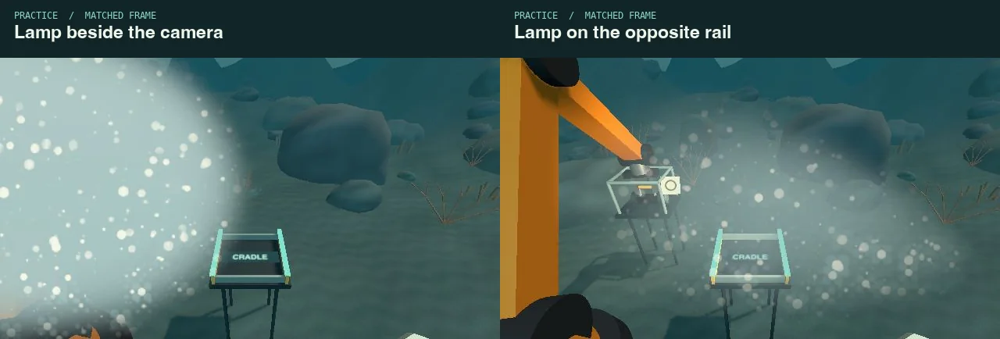

# Soundings judging station

A marine robotics instructor can use this two-minute exercise before a pool session. Ask a student to predict which rig can illuminate and grasp a new target. Their design choices, camera stills and measured approach distance give the instructor a record to discuss afterward.

## Before handing over the Quest

Start the server and set up USB forwarding as described in the [README](../README.md). Enter VR on the Quest, open the spectator view on the laptop, and confirm the sound output is audible. Keep the Quest's right controller handy for a controller-only run. For sponsored judging, use the normal launch with the team key and confirm **Orbis live** before starting. The practice and live paths have distinct source labels.

## Two-minute run

| Time | Give the judge this direction | What the audience should see |
| --- | --- | --- |
| 0:00–0:20 | “Here is your underwater robot. Where would you put its light?” Let them sight along the camera, select the port arm and a lamp position, and touch the practice handle with the jaws. | The dock check confirms the hand-to-arm mapping. |
| 0:20–0:45 | “You are recovering a sound recorder in Monterey Canyon. Predict what could stop you.” Launch, point the jaws at the pickup and read the plate beside its handle. | The spectator sees the same water and gripper as the pilot. |
| 0:45–1:10 | “Hold the robot here. What happens to the symbol when the water changes?” Use the water test. Let the judge capture the second frame when the change is visible. | One session steers while the robot stays fixed. Capture time comes from displayed imagery. |
| 1:10–1:40 | “If you need to, move one part and try again.” On the primary site, the port arm reaches the handle. An inward-aimed lamp on the opposite rail can illuminate it across the field of view. Lift straight up before crossing the cage edge, then open over the cradle. | A short arm physically stops; an obscured pickup remains graspable. A correct first rig can succeed immediately. |
| 1:40–2:00 | “Listen to what you brought back. Which arm rail will work on the opposite pickup?” Show the same-frame lamp comparison, then select the mirrored challenge. | The recovered clip plays. Both predictions and outcomes remain in the dive files. |

For another judge, select **Next pilot** in the Quest debrief or **Reset mission** on the desktop. If a steer takes time to appear, keep the pose fixed and wait for a visible change before capturing it. If the stream falls back, the display indicates practice. Reconnect and repeat the live trial before presenting it as a sponsor demo. Close the pilot tab after judging to end the live session.

## Design and evidence

Three.js computes arm reach, the cage constraint, grasp, release, camera position and light direction. Orbis supplies a continuous underwater video, sampled into the pilot view. A per-pixel estimate of overlap between the light and viewing rays controls how foreground particle detail veils the local instrument. Educational evidence comes from the image the pilot actually saw, the reported symbol and the motion trace. The optical model is a teaching approximation.



The recovery audio is a credited CC0 humpback recording used in a fictional canyon mission. The compact recorder housing was generated with Meshy smart topology; the handle, tag, cage and mounting geometry are local game geometry. The application runs in the existing Three.js/WebXR stack.

## Verification

The November 15 release build passed. A browser smoke test loaded the built workbench, mounted camera, recorder model, audio and local API. All 80 unit and replay tests passed on this checkout. Replay counts vary with the number of local recordings.

Eleven browser tests passed. They exercised a missed reach, a refit, first-build recovery, the mirrored pickup, per-attempt files, spectator delivery and a second judge after reset. A synthetic Orbis transport supplied decoded video to the actual pilot UI. It verified one continuous session, a new displayed frame after steering, and rejection of stale frames and mixed practice/live pairs. The legacy Backlot policy test requires separately trained checkpoints and a results file and was skipped in this checkout.

In a controlled decoded-video test, symbol contrast measured 3.60:1 in clear water and 1.41:1 in dense water with the robot fixed. Moving the lamp from beside the lens to the opposite rail changed contrast from 1.04:1 to 3.69:1 against the same frozen practice water. Re-rendering the original rig and frame reproduced the original pilot image pixel for pixel. These measurements use test imagery.

Two Quest 3 practice rehearsals in Meta's IWER emulator completed the dock check, prediction, water capture, symbol readback, hand-controlled recovery and reset. Controller rays also exercised socket placement and lamp aim. The two canyon records held 161 and 171 motion samples respectively, with one fixed-pose water comparison per record. Physical headset comfort, human timing and the live Orbis response remain venue checks.

### Reproduce the checks

The full browser suite also runs the older Backlot data factory, which needs a local Python environment. From the repository root on macOS or Linux:

```sh
npm ci
python3 -m venv .venv
.venv/bin/python -m pip install numpy websockets
npx playwright install chromium
npm run build
npm test
npm run e2e
```

For the optional immersive practice rehearsal, start `npm run dev`, then run `node scripts/rehearse-quest.mjs /path/to/iwer-2.8.0/package/build/iwer.min.js` with a local copy of the IWER 2.8.0 distribution. The script writes bench, pilot and debrief screenshots under `e2e-shots/soundings-emulated/`.

### Goal for the on-site agent

Put Soundings through two timed recoveries on a physical Quest 3 with the Visko team key. Use the same judging station that will be on stage. Have a first-time player choose a rig for the opposite-side pickup before seeing its reach. Deliver the two session IDs, displayed pilot-frame pairs and measured times, plus a sentence about the learner's prediction and what actually happened. If the player gets stuck or the symbol never changes legibility, fix that interaction and repeat the affected run before judging.

The verification agent needs Quest Browser, Android Platform Tools (`adb`) and the repository's Node environment. The installed Reactor SDK connects the game to Visko. Meshy 3D is optional for revising the recorder housing. The headset build and rehearsal run directly in WebXR.

1. Set the key on the server, restart, authorize the USB connection and launch the normal game URL on the headset. Open the spectator URL on the laptop. Wait for **Orbis live** and moving water in the pilot camera. The raw source inset appears during the water test.
2. In the canyon, lock the pose and steer the water. Have the player read the symbol before and after the visible change. Capture it. Recover the recorder, confirm that the whale clip is audible, and compare the alternate lamp position on one frozen frame.
3. Try the mirrored pickup. Then select **Next pilot** and run the two-minute mission again. Hand the Quest to a second player if one is available. Exercise hand tracking and the controller fallback across the two runs. Confirm the laptop feed follows the headset.
4. In `data/soundings/sessions/`, locate two distinct session IDs. Check that both relevant canyon records have `immersive: true`, the expected input, a recovery outcome and a water comparison with two `live` sources, advancing media timestamps and matching poses. Attach those frame pairs and the observed symbol readings to the demo record.
