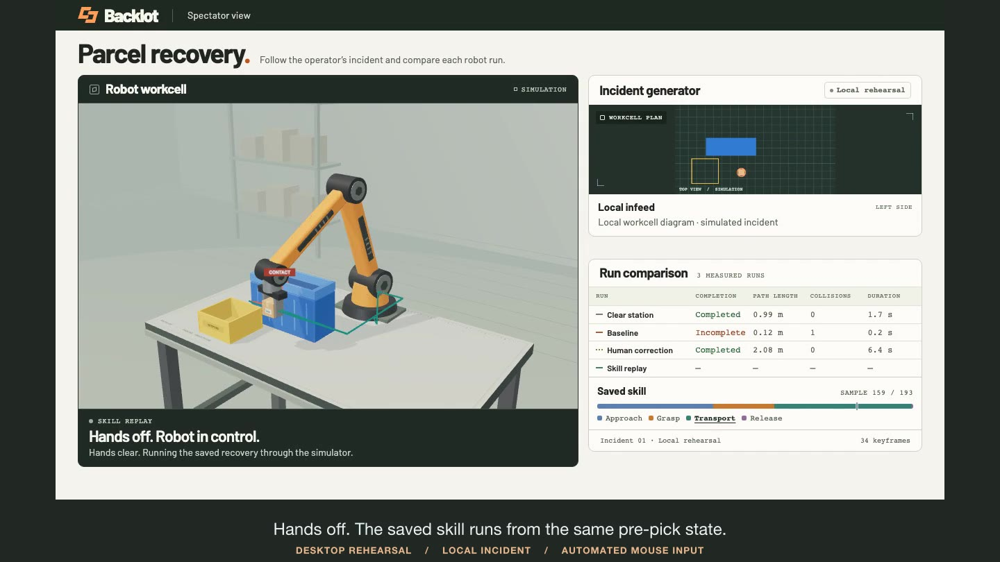

# Recorded rehearsal

[Watch the narrated demo (44 seconds)](media/backlot-recovery.mp4) · [Download the recorded episode (compressed JSON)](media/rehearsal-episode.json.gz) · [Run the station](../README.md#start-the-station)

The recording follows the audience display during one continuous simulation session. In a separate browser window, Playwright operated the gripper through the same mouse and keyboard controls a desktop user uses. The two blue tote placements came from the local rehearsal mode. The video includes the saved skill running after the operator reloaded the page.



## Outcomes

The table gives actual tip travel, distinct contact entries and elapsed simulation time for session `2026-11-15T11-25-03Z-a7c5`. Contact stops the active run, so a blocked trial may have a much shorter path than a successful delivery.

| Layout | Run | Delivered | Tip travel | Contacts | Time |
| --- | --- | --- | ---: | ---: | ---: |
| Clear | Standard pick | Yes | 0.994 m | 0 | 1.73 s |
| Left tote | Standard pick | No | 0.120 m | 1 | 0.23 s |
| Left tote | Operator demonstration | Yes | 2.076 m | 0 | 6.43 s |
| Left tote | Saved skill | Yes | 2.072 m | 0 | 6.43 s |
| Left tote | Saved skill after reload | Yes | 2.072 m | 0 | 6.43 s |
| Right tote | Standard pick | No | 0.140 m | 1 | 0.27 s |
| Right tote | Same saved skill on fresh incident | No | 0.521 m | 1 | 1.27 s |

On the first incident, the palm struck the tote at 0.208 s. The demonstration went around its free end. Backlot recorded 193 samples at 30 Hz and reduced them to 34 executable keyframes. The four phases spanned samples 0–70 (approach), 71–107 (grasp), 108–191 (transport) and 192 (release). Both original-incident replays started from the same pre-pick checkpoint and delivered the carton. With the tote on the other side, the left finger hit it at 1.239 s. The episode preserves that failure alongside the successful trials.

## Reproduce the checks

This run used Chromium 159.0.8154.6 and Playwright 1.65.1 on an Apple silicon Mac running macOS 15.7.4. A second Chromium context received the audience cast. To inspect the published evidence, run `gzip -dc docs/media/rehearsal-episode.json.gz > /tmp/backlot-rehearsal.json`. Each trial contains its initial and final states, raw samples, contact events and metrics. The demonstration also contains its phase spans and processed skill.

```sh
npm ci
npx playwright install chromium
npm test
npm run build
RECORD_RECOVERY=1 npm run e2e -- e2e/recovery.spec.ts
npm run e2e -- e2e/recovery-stream.spec.ts
```

The second browser test uses a synthetic video stream at the Reactor SDK boundary. It requests a left incident, receives a visible tote on the right, captures the decoded frame, and checks that the confirmed right lane controls the collision geometry. It also exercises a second prompt on the same connection and recovery from a stream interruption.

The full browser suite passed nine scenarios across Recovery and the original workbench. One optional legacy policy test skipped because this checkout has no trained checkpoints or matching evaluation summary. All 19 Python regression tests passed. The unit suite also re-executes each of the seven trials in the published episode and compares its outcomes and contact geometry.

## Live Quest handoff

When the team key and headset are available, follow the [Quest setup](../README.md#connect-orbis-and-quest). Verify a real Orbis steer and mark a tote in a captured frame. Check that the matching simulated contact is visible in the headset and on the cast, then record one hand-guided delivery and replay it. The current recording covers desktop simulation. The team deferred the combined physical-headset and live-service rehearsal.
